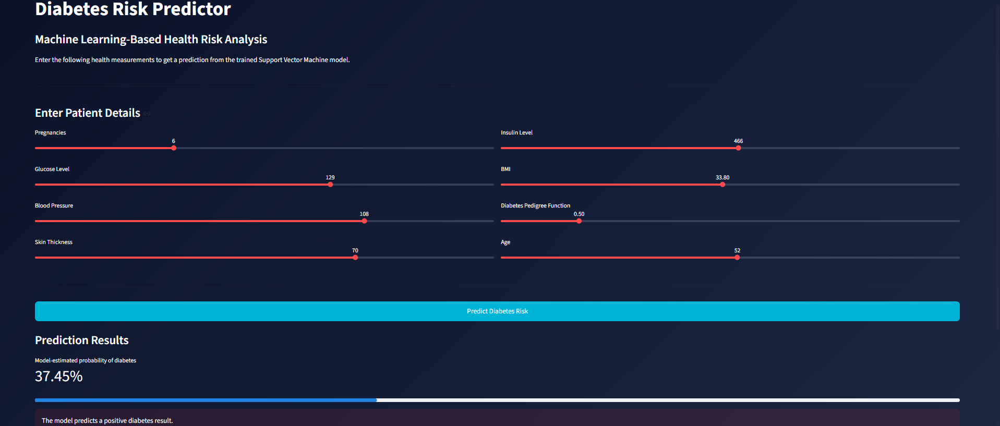

# Diabetes Prediction System Using Machine Learning

An interactive **Diabetes Prediction System** developed using Python, Machine Learning, and Streamlit. This project uses a **Support Vector Machine (SVM)** classifier to predict diabetes outcomes based on patient health measurements.

The model is trained and evaluated in a Jupyter Notebook. The trained model and fitted StandardScaler are saved and integrated into a Streamlit application, allowing users to generate predictions without retraining the model every time the application runs.

## Application Preview



## Features

- Machine Learning-based diabetes prediction using SVM.
- Data preprocessing and feature scaling.
- Model training and evaluation using Scikit-learn.
- Saved model and scaler for reuse.
- Interactive Streamlit web application.
- Eight health-related input parameters.
- Prediction results with estimated positive-class probability.
- Visual probability indicator and result categories.

## Technologies Used

| Technology | Purpose |
|---|---|
| Python | Programming language |
| Pandas | Data manipulation |
| NumPy | Numerical operations |
| Scikit-learn | Machine Learning |
| Support Vector Machine (SVM) | Classification algorithm |
| StandardScaler | Feature scaling |
| Streamlit | Web application |
| Pickle | Saving and loading trained model files |
| Jupyter Notebook | Model development and evaluation |

## Project Structure

```text
Diabetes-Prediction-System-Using-Machine-Learning/
│
├── app.py
├── train_model.ipynb
├── diabetes.csv
├── diabetes_model.pkl
├── scaler.pkl
├── requirements.txt
├── .gitignore
├── README.md
└── app_preview.png
```

## Dataset Description

The project uses a diabetes dataset containing patient health measurements and a target variable named `Outcome`.

### Dataset Features

| Feature | Description |
|---|---|
| Pregnancies | Number of pregnancies |
| Glucose | Glucose concentration |
| BloodPressure | Diastolic blood pressure |
| SkinThickness | Triceps skinfold thickness |
| Insulin | Insulin level |
| BMI | Body Mass Index |
| DiabetesPedigreeFunction | Diabetes pedigree function |
| Age | Patient's age |
| Outcome | Target variable |

### Target Variable

- `0` – Negative diabetes outcome
- `1` – Positive diabetes outcome

## Machine Learning Workflow

### 1. Data Loading and Exploration

The dataset is loaded using Pandas and explored through:
- Dataset dimensions and structure
- Missing-value inspection
- Statistical summaries
- Target variable distribution

### 2. Data Preprocessing

The dataset is separated into input features and the target variable. The data is divided into training and testing sets using `train_test_split()`.

### 3. Feature Scaling

`StandardScaler` is used to standardize the input features.

The scaler is fitted on the training data and then applied to the testing data to prevent data leakage.

### 4. Model Training

A Support Vector Machine classifier is trained using the following configuration:

- Kernel: Linear
- Class Weight: Balanced
- Probability Estimation: Enabled

### 5. Model Evaluation

The trained model is evaluated using:
- Training accuracy
- Testing accuracy
- Classification report

### 6. Model Saving

The trained classifier and fitted scaler are saved using Pickle:

- `diabetes_model.pkl` – Stores the trained SVM model.
- `scaler.pkl` – Stores the fitted StandardScaler.

These saved files are loaded directly into the Streamlit application.

## Streamlit Application

The application provides an interactive interface where users can enter the following health measurements:

1. Pregnancies
2. Glucose Level
3. Blood Pressure
4. Skin Thickness
5. Insulin Level
6. BMI
7. Diabetes Pedigree Function
8. Age

After entering the values, users can click the **Predict Diabetes Risk** button.

The application:
1. Loads the saved SVM model and scaler.
2. Accepts user input through Streamlit sliders.
3. Converts the input into a numerical array.
4. Applies the previously fitted StandardScaler.
5. Generates a prediction using the trained SVM model.
6. Calculates the estimated probability of a positive outcome.
7. Displays the prediction and probability indicator.

**Important:** The application does not train the model again. Model training and evaluation are performed in `train_model.ipynb`.

## Installation and Setup

### 1. Clone the Repository

```bash
git clone https://github.com/YOUR-USERNAME/Diabetes-Prediction-System-Using-Machine-Learning.git
```

### 2. Navigate to the Project Directory

```bash
cd Diabetes-Prediction-System-Using-Machine-Learning
```

### 3. Create a Virtual Environment (Optional)

```bash
python -m venv venv
```

Activate it on Windows:

```bash
venv\Scripts\activate
```

### 4. Install Dependencies

```bash
pip install -r requirements.txt
```

### 5. Run the Streamlit Application

The repository already contains the trained model and scaler files, so you do not need to retrain the model to run the application.

Execute:

```bash
streamlit run app.py
```

The application will open in your default web browser.

### 6. Retrain the Model (Optional)

To train the model again:

1. Open `train_model.ipynb` in Jupyter Notebook.
2. Make sure `diabetes.csv` is available in the project directory.
3. Execute the notebook cells.
4. Run the final model-saving cell.

This generates updated `diabetes_model.pkl` and `scaler.pkl` files.

## Model Files

| File | Description |
|---|---|
| `train_model.ipynb` | Data preprocessing, model training, and evaluation |
| `diabetes_model.pkl` | Saved trained SVM classifier |
| `scaler.pkl` | Saved fitted StandardScaler |
| `app.py` | Streamlit prediction application |
| `diabetes.csv` | Dataset used for model training |

The model and scaler must be generated using the same feature order and preprocessing approach expected by the application.

## Requirements

The project dependencies are listed in `requirements.txt`:

- Streamlit
- NumPy
- Pandas
- Scikit-learn

## Limitations

- Predictions depend on the dataset and model used for training.
- Estimated probabilities are not clinically validated risk estimates.
- The low, moderate, and high probability categories are illustrative thresholds, not established medical standards.
- Model performance may vary on data from different populations.
- The system is intended for educational and machine learning demonstration purposes.

## Future Enhancements

- Hyperparameter tuning to improve model performance.
- Comparison with Logistic Regression, Random Forest, and other classifiers.
- Additional model evaluation visualizations.
- Improved user interface and result presentation.
- More robust input validation.
- Testing on independent datasets.

## Disclaimer

This project is developed for educational and research purposes only. It is not a medical diagnostic tool and should not be used as a substitute for professional medical advice, diagnosis, or treatment. Consult a qualified healthcare professional for medical decisions.

## Author

**Simrat Kaur**

B.Tech – Computer Science and Engineering  
Specialization: Artificial Intelligence and Machine Learning
